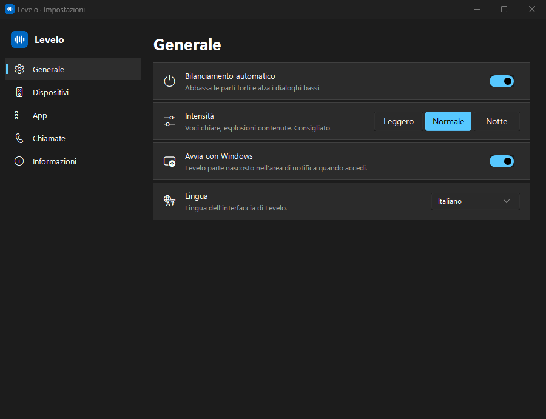

# Levelo

**Basta alzare e abbassare il volume durante i film.**
Le esplosioni vengono domate e i sussurri alzati, in automatico, per tutte le app del PC.

[Scarica](https://github.com/Xillo23/levelo/releases/latest) · [English](README.md) · [Come funziona](#come-funziona) · [Domande frequenti](#domande-frequenti)

> [!NOTE]
> **Levelo è in beta pubblica.** Funziona, ma non è ancora stato provato su molti PC.
> Se sul tuo qualcosa non va, [apri una segnalazione](https://github.com/Xillo23/levelo/issues).
> La versione 1.0 è prevista per febbraio.

---

La solita storia: alzi il volume per capire i dialoghi e alla prima scena d'azione ti
sfondi i timpani. **Levelo** risolve il problema: sta nell'area di notifica e
tiene tutto a un livello comodo, in tempo reale.

- 🗣️ **Prima i dialoghi**: Levelo trova le voci (il centro del mix, o il canale centrale
  del 5.1/7.1) e tiene *ogni battuta* allo stesso livello comodo.
- 💥 **L'azione mai molto più forte delle voci**: musica, esplosioni e spari restano a pochi
  dB dai dialoghi, e i colpi improvvisi vengono tagliati in 10-30 ms.
- 📺 **Stesso risultato con qualsiasi sorgente**: un film basso, un video YouTube forte, un
  servizio di streaming che suona basso, il player al 30%: le voci arrivano allo stesso livello.
- 🎚️ **Usi il volume di Windows come sempre**: tasti, barra delle applicazioni, casse. Non c'è uno slider in più.
- 🌙 **Tre intensità**: *Leggero*, *Normale* e *Notte* (tutto quasi allo stesso livello).
- 🎧 **Le chiamate restano com'erano**: guardi un film con gli amici su Discord, Teams, Zoom o WhatsApp? Le loro voci tengono il loro volume e non fanno abbassare il film.
- 🔊 **Uno o più dispositivi**: segue l'uscita predefinita, oppure bilancia casse e cuffie insieme.
- 🧩 **Scegli le app**: tutte le app che usano l'audio sono in elenco, con un interruttore per lasciarle stare.
- 🪶 **Leggero e privato**: niente account, nessun tracciamento, niente driver. L'audio non esce dal PC.
- 🌍 **11 lingue**.

### Misurato su un film vero

Su un mix "da blockbuster" del film libero *Tears of Steel* (dialoghi calmi, scene di
battaglia con voci sotto la musica forte; si riproduce con `python tools/film_bench.py`):

| | Azione più forte dei dialoghi di | Livello dei dialoghi, sorgente da +8 a −12 dB |
|---|---|---|
| Senza Levelo | 14,4 dB | cambia di 20 dB |
| Levelo 0.9.8 | 7,9 dB | cambia di 4,4 dB |
| **Levelo 0.10 — Normale** | **5,7 dB** | **cambia di 0,2 dB** |
| **Levelo 0.10 — Notte** | **4,4 dB** | **cambia di 0,2 dB** |

## Installazione

1. Scarica **`Levelo-x.y.z-Setup.exe`** dall'[ultima release](https://github.com/Xillo23/levelo/releases/latest).
2. Avvialo. Non servono permessi di amministratore.
3. Fatto: Levelo parte nell'area di notifica, vicino all'orologio.

Esiste anche una **versione portable** in zip. Requisiti: Windows 10 o 11 a 64 bit.

## Uso

Non devi fare niente. Il click sull'icona apre il pannello, dove trovi:
- l'**interruttore** per attivare o mettere in pausa;
- un **grafico** di cosa sta facendo (▲ alza, ▼ abbassa);
- l'**intensità**;
- l'opzione **Avvia con Windows**;
- l'**ingranaggio ⚙** che apre le **Impostazioni**: dispositivi, app, chiamate, lingua.

Il click destro apre il menu: intensità, impostazioni, lingua, avvio automatico, esci.

> **Consiglio:** per alzare le voci basse serve un po' di margine. Se il volume di Windows
> è al 100% le scene forti vengono comunque abbassate, ma le voci basse si alzano poco:
> metti Windows a circa 50% e alza casse, TV o monitor. Levelo te lo segnala una volta.

## Come funziona

1. **Ascolta** l'audio in uscita del PC (loopback WASAPI) a blocchi di 10 ms.
2. **Trova le voci**: nei film i dialoghi stanno al centro del mix stereo (o nel canale
   centrale del 5.1/7.1). Levelo prende ciò che è uguale a sinistra e a destra nella banda
   della voce, toglie la parte stabile (musica ed effetti al centro) e un piccolo
   rilevatore di parlato, addestrato su colonne sonore di film, capisce quando qualcuno parla.
3. **Misura il volume percepito** con la pesatura K (standard ITU-R BS.1770): delle voci,
   tenuto tra una battuta e l'altra, e di tutto il resto.
4. **Calcola la correzione**:
   - le voci vanno a un livello di riferimento (per questo ogni sorgente suona uguale);
   - musica e azione possono essere solo pochi dB più forti delle voci;
   - i colpi improvvisi vengono tagliati subito, e dopo una scena forte il volume torna in
     circa mezzo secondo per sentire la battuta successiva;
   - il silenzio non viene mai alzato.
5. **La applica al volume delle singole app** (mixer di Windows), non al volume generale.
   Le app nuove vengono abbassate appena aprono l'audio.
6. **Rimette tutto com'era** in pausa, all'uscita, alla disinstallazione, al cambio di
   dispositivo e anche dopo un crash (al riavvio successivo).

**Limiti:** i primi 10-30 ms di un colpo improvviso passano prima del taglio. E Levelo
cambia il volume, non il mix: quando si parla *sopra* una musica forte tiene la scena un po'
più alta per non schiacciare le parole, ma non può separare la voce dalla musica.

## Domande frequenti

**Windows SmartScreen dice "PC protetto da Windows".**
Succede con le app nuove senza un certificato di firma a pagamento. Clicca *Ulteriori
informazioni* → *Esegui comunque*. Il codice sorgente completo è in questo repository.

**Funziona con cuffie, Bluetooth e HDMI?** Sì. Di base segue il dispositivo predefinito di
Windows e cambia insieme a lui. In Impostazioni → *Dispositivi* puoi sceglierne uno o più da
bilanciare insieme (per esempio casse e cuffie).

**Posso escludere un'app?** Sì: Impostazioni → *App*, spegni il suo interruttore (oppure usa
*Aggiungi un'app…* se non è ancora in elenco). Le app di chiamata sono escluse in automatico.

**Sono in chiamata su Discord: abbassa anche il mio amico?** No. Discord, Teams, Zoom,
WhatsApp, Telegram e simili restano al loro volume, e la voce di chi parla non fa abbassare il
film. Le chiamate fatte dentro una scheda del browser invece non si possono separare.

**Si collega a internet?**
Solo per controllare gli aggiornamenti: due volte al giorno scarica due file pubblici da questo
repository GitHub. Non invia nessun dato su di te o sul tuo PC.

**Rallenta il PC?** No, usa pochi punti percentuali di un solo core, molto meno dell'1% del processore.

## Sostieni il progetto

Levelo è gratuito e open source, senza pubblicità né tracciamento. Se ti ha salvato le
orecchie, **[offrimi un caffè su Ko-fi](https://ko-fi.com/xillo23)** ☕❤️

## Licenza

[GPL-3.0](LICENSE).
