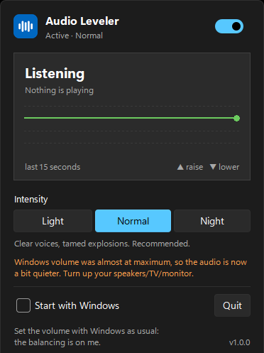
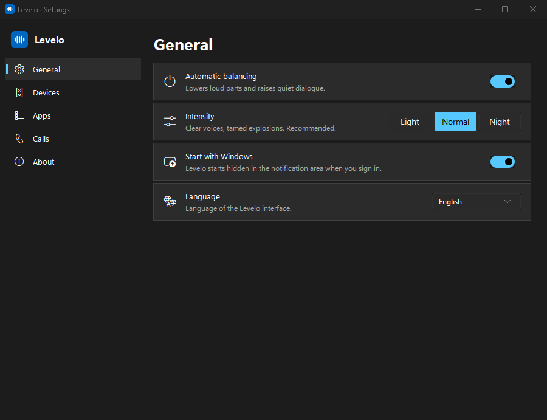

<div align="center">


# Levelo

**Stop riding the volume during movies.**
Explosions get tamed, whispers get lifted, automatically, for every app on your Windows PC.

[Download](https://github.com/Xillo23/levelo/releases/latest) · [Italiano](README.it.md) · [How it works](#how-it-works) · [FAQ](#faq)


[](https://ko-fi.com/xillo23)



</div>

> [!NOTE]
> **Levelo is in public beta.** It works and is used every day, but it hasn't been tested on
> many PCs yet. If something doesn't work on yours, please [open an issue](https://github.com/Xillo23/levelo/issues).
> Version 1.0 is planned for February.

---

You know the routine: you turn the volume up to understand the dialogue, then the
next action scene blows your ears off. **Levelo** fixes that. It sits in the
notification area and keeps everything at a comfortable level in real time:

- 🗣️ **Dialogue first**: Levelo finds the voices (the centre of the mix, or the centre
  channel of 5.1/7.1) and keeps *every line* at the same comfortable level.
- 💥 **Action never much louder than the voices**: music, explosions and gunshots are
  kept within a few dB of the dialogue, and sudden hits are cut in ~10–30 ms.
- 📺 **Same result with any source**: a quiet movie, a loud YouTube video, a streaming
  service that plays low, the player at 30%: the voices end up at the same level.
- 🎯 **Nothing to set up, whatever your speakers**: Levelo learns the level of what you
  usually watch (your volume is already set for it) and brings everything else to it.
  Music and games are levelled too.
- 🎚️ **You keep using the normal Windows volume** (keys, taskbar, speakers). There's no extra slider.
- 🌙 **Three intensities**: *Light*, *Normal* and *Night* (everything at almost the same level, great for late-night watching).
- 🎧 **Voice calls are left alone**: watching with friends on Discord, Teams, Zoom or WhatsApp? Their voices keep their volume and don't make the movie quieter.
- 🔊 **One or more devices**: follows your default output, or balances speakers and headphones at the same time.
- 🧩 **Choose the apps**: every app that plays sound is listed, with a switch to leave it alone.
- 🪶 **Lightweight and private**: no account, no tracking, no drivers to install. Audio never leaves your PC.
- 🌍 **11 languages**: English, Italiano, Español, Deutsch, Français, Português, Русский, Polski, Türkçe, 简体中文, 日本語.

Works with any app that plays sound: browsers (Netflix, YouTube, Prime Video…), VLC,
MPC-HC, Plex, games, and more.

### Measured on a real film

On a blockbuster-like mix of the open movie *Tears of Steel* (calm dialogue, battle
scenes with voices under loud music; reproduce it with `python tools/film_bench.py`):

| | Action louder than the dialogue by | Dialogue level, source from +8 to −12 dB |
|---|---|---|
| Without Levelo | 14.4 dB | changes by 20 dB |
| Levelo 0.9.8 | 7.9 dB | changes by 4.4 dB |
| **Levelo 0.10 — Normal** | **5.9 dB** | **changes by 0.2 dB** |
| **Levelo 0.10 — Night** | **4.4 dB** | **changes by 0.2 dB** |

<div align="center">

</div>

## Download and install

1. Download **`Levelo-x.y.z-Setup.exe`** from the [latest release](https://github.com/Xillo23/levelo/releases/latest).
2. Run it. No administrator rights are needed: it installs for your user only.
3. Done. Levelo starts in the notification area, next to the clock.

A **portable zip** is also available: extract it anywhere and run `Levelo.exe`.

Requirements: Windows 10 or 11 (64-bit).

## How to use it

There's nothing to do: set the volume as you always do. Click the tray icon to open the panel:

| Control | What it does |
|---|---|
| Switch | Turns balancing on or off. Volumes are restored instantly. |
| Live graph | What it's doing right now: ▲ raising, ▼ lowering. |
| Intensity | **Light**: keeps the movie's dynamics · **Normal**: recommended · **Night**: maximum leveling |
| Start with Windows | Starts hidden in the notification area at login. |
| ⚙ Settings | Opens the Settings window: devices, apps, voice calls, language. |

Right-click the icon for the menu: intensity, settings, language, start with Windows, quit.

**Voice calls:** Discord, Teams, Zoom, WhatsApp, Telegram and similar apps are left alone
by default: your friend's voice keeps its volume and doesn't make the movie quieter.

> **Tip:** to raise quiet voices, Levelo needs a bit of room. If your Windows volume is
> at 100%, loud scenes are still lowered but quiet voices can only be raised a little:
> set Windows to about 50% and turn up your speakers/TV/monitor instead. Levelo tells you
> once when this happens.

## How it works

1. **Listens** to the PC's audio output (WASAPI loopback) in 10 ms blocks.
2. **Finds the voices.** In films the dialogue is in the centre of the stereo mix (or in
   the centre channel of 5.1/7.1): Levelo takes what is common to left and right in the
   voice band, removes the steady part (music and effects in the centre), and a small
   speech detector, fitted on film soundtracks with known dialogue, tells when someone
   is talking.
3. **Measures perceived loudness** with K-weighting (the ITU-R BS.1770 broadcast
   standard): of the voices, held between lines, and of everything else.
4. **Computes a correction**: the voices go to a reference level (that's why every source
   ends up the same), learned from what you usually watch so your usual content keeps
   the loudness you chose; without voices (music, games) the programme level is used; music and action may be only a few dB louder than the voices; sudden
   hits are cut at once; after a loud scene the volume comes back in about half a
   second so the next line is heard. It never boosts silence.
5. **Applies it to the per-app volumes** (the Windows volume mixer), not to the master
   volume, so your volume slider stays yours. To be able to *raise* audio it keeps apps up
   to 15 dB lower and raises the master by the same amount, so overall loudness doesn't
   change. New apps are lowered as soon as they open their audio.
6. **Restores everything** when you pause, quit, uninstall, switch audio device, or even
   after a crash (on the next start).

Because the captured audio is already attenuated by the volumes the app sets, the
measurement subtracts them to see the *original* signal. That avoids the feedback loop
that makes simpler auto-volume tools oscillate.

**Limitations:** the very first 10–30 ms of a sudden hit get through before the cut, a
short "tick" rather than a full blast. And Levelo changes the volume, not the mix: when
someone talks *over* loud music it keeps the scene a bit louder so the words are not
pushed down, but it can't separate the voice from the music. Both would need a virtual
audio driver, which is on the roadmap as an optional mode.

## FAQ

**Windows SmartScreen says "Windows protected your PC".**
New apps without a paid code-signing certificate show this warning. Click *More info* →
*Run anyway*. The full source code is in this repository and every release is built
from it.

**My antivirus flags it.**
Apps packaged with PyInstaller sometimes trigger false positives. Please report it to your
antivirus vendor, and open an issue so we can track it.

**Does it work with headphones / Bluetooth / HDMI?**
Yes. By default it follows the current Windows default output device and switches with
it. In Settings → *Devices* you can choose one or more devices to balance at the same time
(for example speakers and headphones).

**Can I exclude an app?**
Yes: Settings → *Apps*, turn its switch off (or use *Add an app…* if it isn't listed yet).
Voice-call apps are excluded automatically.

**I'm in a Discord call: does it lower my friend too?**
No. Discord, Teams, Zoom, WhatsApp, Telegram and similar apps keep their volume, and the voice
of whoever is talking doesn't make the movie quieter. Calls made inside a browser tab can't be
separated from the rest of the browser, though.

**Does it connect to the internet?**
Only to check for updates: twice a day it downloads two public files from this GitHub
repository (the latest release info and `links.json`). Nothing about you or your PC is sent.

**Does it slow down my PC?**
No. It uses a few percent of a single CPU core, well under 1% of the whole processor.

## Build from source

```powershell
git clone https://github.com/Xillo23/levelo.git
cd levelo
pip install -r requirements.txt -r requirements-dev.txt
python -m unittest discover -s tests      # tests
$env:PYTHONPATH="src"; python -m levelo   # run
python build.py                           # dist/ : installer + portable zip
```

The installer requires [Inno Setup 6+](https://jrsoftware.org/isdl.php).

Project layout:

```
src/levelo/   dsp.py (leveling algorithm) · engine.py (Windows audio) · ui.py (panel + tray)
                    i18n.py (translations) · winsys.py (autostart, single instance, theme)
packaging/          Inno Setup script + PyInstaller entry point
tests/              simulated movie soundtrack through the leveler
tools/film_bench.py benchmark on a real film soundtrack (Tears of Steel, CC-BY)
```

## Contributing

- 🌍 **Translations**: add a block to `src/levelo/i18n.py` and open a pull request.
  A test checks that every language has all the strings.
- 🐞 **Bugs and ideas**: [open an issue](https://github.com/Xillo23/levelo/issues).

## Support the project

Levelo is free and open source, with no ads, no tracking and no locked features.
If it saved your ears (or your neighbours' sleep), consider supporting its development. ❤️

**[☕ Buy me a coffee on Ko-fi](https://ko-fi.com/xillo23)**

No nagging: after many hours of balanced audio, the app shows a small card in its panel
**at most three times**, and stays quiet for a year once you click "donate" or
"I already donated". The usage counters it
shows (hours balanced, loud moments tamed) are stored only on your PC.

## License

[GPL-3.0](LICENSE). You may use, study, share and modify it. Derivative works must stay open source.
